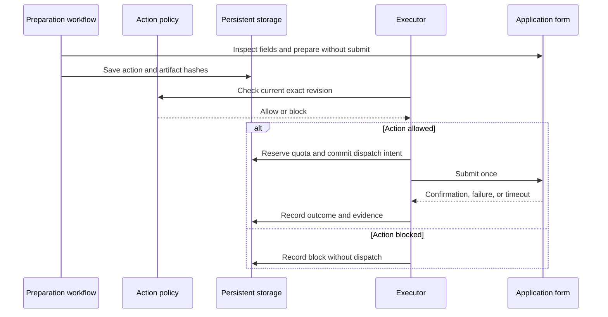

# Application materials, submissions, and LinkedIn outreach

_Design baseline · 2026-09-30 · Requirements R01, R08–R11 · Decisions ADR-03 and ADR-04_

---

## 📋 Candidate facts and document preparation

Import a user-supplied baseline CV and extract text/fact proposals locally using pypdf for searchable PDFs[^1]. Initial input support is a searchable PDF or pasted text; scanned documents and other formats require conversion or a later adapter. Limit initial imports to 10 MB and 20 pages, and perform parsing in a resource-limited subprocess with a 30-second deadline and a 512 MB memory ceiling. A compressed-file limit alone does not bound PDF extraction memory[^1]. Extracted facts are `unconfirmed` until the user approves them in Telegram. Contact details, education, dates, projects, skills, eligibility, and availability must be represented in the confirmed profile before use in outbound materials.

Create a tailored document specification from confirmed facts and the current opportunity. Select and reorder relevant experience, rewrite phrasing, and emphasize supported skills; do not invent employers, degrees, dates, accomplishments, proficiency, or quantitative impact. Keep the original baseline immutable. Include a change summary and the fact IDs supporting each generated claim.

Render a simple single-column CV to searchable PDF using controlled HTML/CSS and Playwright's PDF rendering[^2]. Use the same rendering boundary for cover-letter PDFs and retain plain text for form fields. The renderer owns templates; generated text is escaped and cannot supply executable HTML, scripts, or remote-resource URLs. This is a formatting choice, not a promise that every applicant-tracking system will parse the document correctly.

Artifacts are immutable after publishing: record checksum, template/model versions, fact IDs, profile revision, role ID, and local path. Validate text extraction, required contact fields, missing sections, page overflow, and visual layout before an artifact is eligible for submission. Telegram delivers previews and a concise tailoring summary.

## 🔧 Screening answers and form support

Use confirmed facts or a user-confirmed reusable answer for each question. Work authorization, sponsorship, compensation expectations, availability, eligibility, and personal declarations require explicit user facts. Unknown or ambiguous questions block preparation and become a Telegram question; neither model confidence nor a suggested default can fill them.

Optional demographic disclosures remain blank or use a user-selected non-disclosure option when available. Required sensitive disclosure requires an explicit answer. Do not infer demographic attributes. Consent/declarations must be covered by an explicit user rule or per-action approval; unrecognized declarations block final submission.

| Form class | Baseline behavior |
| --- | --- |
| Tested LinkedIn Easy Apply flow | Inspect each step; populate supported fields; submit through executor |
| Tested Greenhouse/Lever/Ashby hosted form layout | Use provider-specific browser adapter; obtain no employer API credentials |
| Generic simple public company form | Inspect and prepare; release only after its layout and confirmation gate passes |
| Unrecognized questions, required portal account, assessment, CAPTCHA, or complex flow | Mark unsupported/blocked and provide handoff instructions |

Support is per tested layout/field family, not every employer using the same ATS. Employer-specific required questions remain relevant even when a board API omits them. Validate file constraints, required fields, visible target/company identity, and URL before the final control.

## 🔗 Submission and confirmation

Before dispatch, refresh the job and form, revalidate attached artifact hashes and answers, and compare with the authorized snapshot. A changed question or artifact returns for preparation/approval. Use an application identity shared across LinkedIn and external sources to avoid duplicate submissions.

A click or HTTP status alone is not successful application evidence. Require a target-specific confirmation page/reference or verified applied state. After an ambiguous submission, record `unknown` and reconcile without another submission. A successful application stays `submitted`; subsequent rejection/interview information can be recorded as outcome notes without erasing submission evidence.

The baseline does not withdraw applications or automatically perform assessments. User-recorded applications made elsewhere create deduplication records before future agent execution. State transitions, explicit retries, and daily caps are owned by [autonomy](workflows-and-autonomy.md).

## 📍 LinkedIn communication

Supported actions are replies, initial outreach, one follow-up per outreach thread by default, invitations, and incoming-request decisions. Employer communication remains on LinkedIn; Telegram is user control. Email integration is deferred.

Replies refer to a specific inbound message and use the full locally available thread context. Initial outreach must identify the company/recipient, explain the supported fit, and distinguish interest in a verified vacancy from speculative interest in the company. The model cannot invent a recipient identity or imply a personal relationship.

Follow-up defaults: wait at least seven days after confirmed outreach, require no intervening reply, and send at most one follow-up. Re-check thread state before dispatch. Recipient exclusions, daily caps, campaign deduplication, and user-selected invitation/request rules apply. Rejection or a request to stop closes the outreach sequence.

A new inbound question with an unknown factual answer creates a user question. Acceptance, interview scheduling commitments, compensation negotiation, and personal declarations need explicit rules or approval of the exact reply. Do not make commitments from inferred availability.

## 🎯 Acceptance and validation

V08 verifies grounded generation, V10 verifies PDFs and immutable hashes, V09 verifies authorization, V11–V12 verify dispatch/reconciliation, and V13 verifies correct recipients and follow-up boundaries. M5 enables reviewed effects for supported layouts; M6 enables configured automatic execution after those same gates pass.

## 🔗 References

[^1]: pypdf documentation. "Extract text from a PDF." Checked 2026-09-30. https://pypdf.readthedocs.io/en/stable/user/extract-text.html
[^2]: Playwright Python documentation. "Page.pdf." Checked 2026-09-30. https://playwright.dev/python/docs/api/class-page#page-pdf
