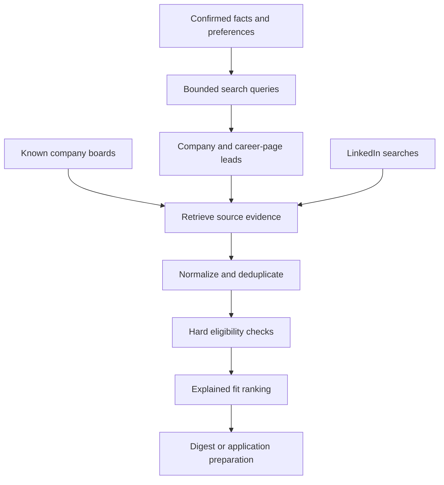

# Independent discovery and opportunity matching

_Design baseline · 2026-09-30 · Requirements R01, R05–R07, R11 · Decisions ADR-01 and ADR-03_

---

## 🎯 Discovery driven by user goals

Build queries from explicit roles, skills, sectors, internship/job types, geographic constraints, company-size preferences, and availability. The model can propose bounded query variants and company leads, but its memory cannot establish that a company is hiring or that a vacancy is current.

Run two complementary paths: monitor already verified company boards, and search for new employers and career pages. Smaller companies without an ATS remain valid targets; retrieve their public career pages and preserve observations. A company with no verified vacancy is an employer lead, not an open opportunity.

The initial search adapter assesses DDGS, which exposes selectable web-search backends[^1]. It remains a best-effort integration; a source outage produces reduced-coverage status while known boards continue. Use a configured backend set and bounded retries, without making paid services or new credentials necessary for baseline discovery.

## 📚 Source adapters and company verification

| Source | Initial collection approach | Important boundary |
| --- | --- | --- |
| Greenhouse | Public job-board GET endpoints for verified board tokens | Submission POST requires employer-side authentication[^2] |
| Lever | Published postings for verified site identifiers | Application POST requires an API key; hosted forms remain a separate path[^3] |
| Ashby | Public posting endpoint for verified board names | Collect job/apply URLs; this is not a general candidate submission credential[^4] |
| Company website | HTTP retrieval; browser rendering when necessary | Respect published access restrictions; record parsing coverage |
| Search engines | Query results and snippets | Follow to primary pages before treating claims as verified |
| LinkedIn | Connector-defined searches and details | Unofficial, bounded capability with its own release gate |

Verify the company through its official domain and an observed link to its career site or ATS board. Record domain aliases and board names from evidence, not guesses. Search-result snippets can seed verification; never submit a CV to an unverified domain simply because the company name matches.

Initial per-research-run defaults are 10 search queries, 20 new company leads, and 50 page retrievals, with a 15-minute wall-time budget. These are workload limits, configurable after measurement. A known-board monitoring run uses its own source pagination budget. Do not spend all discovery capacity re-querying the same large employers; reserve half of new-company query slots for small-company/startup-oriented queries when the user has selected that preference.

Store publication time only if the source supplies it. Preserve `first_seen` and `last_seen` separately. A missing record closes a role only after an explicit closed/not-found result or a complete authoritative board refresh; partial results, parsing failures, or search disappearance do not close it.

## 🔧 Eligibility and ranking

Hard constraints run before scoring: opportunity status, role type, dates, explicit location/remote restrictions, confirmed work authorization requirements, and user exclusions. Missing required candidate facts yield `unknown` eligibility and a question; explicit incompatibility yields `ineligible`. Keep unknowns distinct from a low fit score.

For eligible records, use a transparent weighted score on a 0–100 scale. Default weights are role relevance 35%, supported skill overlap 30%, sector interest 15%, work/location preferences 10%, and company-size/stage preference 10%. If a soft preference is unset, omit that dimension and normalize remaining weights. Unknown source attributes receive no positive evidence for that dimension and are listed as gaps.

Use deterministic matching for explicit facts and constraints. The LLM may normalize titles and assess semantic relevance with evidence references; validate component bounds and retain the rationale. A ranking score is not a probability, a guarantee of hiring, or a self-reported model confidence. Automatic-action thresholds are configured by the user and do not replace hard constraints.

Version each assessment against the candidate/profile and preference revisions. Re-score outstanding opportunities when material preferences change. Before submission, refresh the role and re-check eligibility. Relevant posts use the user's role/sector/interests and explain their relevance separately from job scoring.

## 📍 Feedback and coverage

Telegram feedback can mark opportunities relevant, irrelevant, applied elsewhere, or excluded. Explicit changes create preference revisions; do not silently infer hard constraints from a single rejection. Record whether an opportunity originated from independent company research, a board monitor, user input, or LinkedIn, so discovery can be evaluated separately from the feed.

Digests identify source outages, bounds, unknown facts, and reasons for top matches. Group duplicates under one opportunity with multiple source links. Ranking quality is evaluated against user-labeled fixtures and feedback in [LLM evaluation](llm-and-evaluation.md); source correctness is tested independently.

Acceptance: V04 checks identity/freshness; V06 checks constraints and explanations; V07 checks company verification and source outages; V08 checks model-assisted assessments. Contracts live in [domain and data](domain-and-data.md).

## 🔗 References

[^1]: DDGS project. "README." Checked 2026-09-30. https://github.com/deedy5/ddgs
[^2]: Greenhouse developer documentation. "Job Board API." Checked 2026-09-30. https://docs.greenhouse.io/job-board.html
[^3]: Lever project. "Postings API." Checked 2026-09-30. https://github.com/lever/postings-api
[^4]: Ashby developer documentation. "Ashby Job Postings API." Checked 2026-09-30. https://developers.ashbyhq.com/docs/public-job-posting-api
