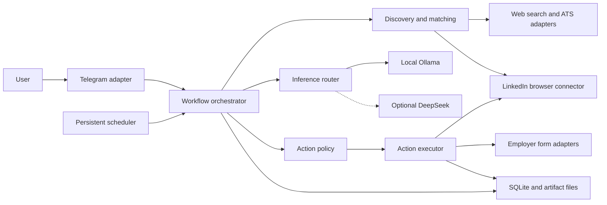

# System architecture and component contracts

_Design baseline · 2026-09-30 · Requirements R01–R14 · Decisions ADR-01–ADR-04_

---

## 📋 Architecture and runtime

Use a modular Python application with one asynchronous runtime, one SQLite database, and local artifact files. Telegram and workflow scheduling share the event loop. A serialized browser lane owns one dedicated LinkedIn context; independent public-source HTTP requests use bounded concurrency. Local inference is provided by an independently installed Ollama runtime.

SQLite does not require a separate database server[^1]. The baseline uses the standard-library driver behind a repository interface. Execute database operations on one dedicated worker thread with a connection owned by that thread; network, browser, and inference calls happen outside database transactions. HTTPX provides an asynchronous client[^2]; reuse a client per adapter rather than instantiate one per request.



No public HTTP API, standalone unofficial LinkedIn service, message broker, vector database, or general-purpose agent framework is required initially. The project-owned connector is a Python interface, so moving it to another process later does not require changing domain behavior.

## 📚 Responsibilities and dependency rules

| Component | Responsibility | Must not own |
| --- | --- | --- |
| Domain | Facts, preferences, eligibility, ranking structures, action transitions | Browser selectors or provider wire formats |
| Workflows | Retrieval, normalization, preparation, scheduling, checkpoints | Direct browser clicks that send or submit |
| Policy | Allow, require approval, or block a concrete action | Generated eligibility facts or hidden overrides |
| Executor | Persist intent, reserve limits, execute, verify, reconcile | Independent opportunity selection |
| Adapters | Telegram, browser, ATS, search, inference, artifact rendering | Autonomous permissions |
| Repositories | Transactions, migrations, durable records | Long-running external calls |

Domain logic imports no SDKs for Telegram, browsers, or inference. Workflows depend on domain types and interfaces; adapters implement those interfaces. The composition root creates clients and injects dependencies. Pydantic models provide boundary validation[^3]; use strict validation, forbid extra fields, and freeze action snapshots, with explicit domain checks for business rules. Document import uses a bounded pypdf subprocess as specified in [applications](applications-and-outreach.md).

Proposed source organization, to be created in M1:

```text
src/linkedin_bot/
  domain/       # contracts, matching, policy, action transitions
  workflows/    # monitoring, research, preparation, execution
  adapters/     # linkedin, ats, search, telegram, llm, documents
  storage/      # repositories and versioned SQL migrations
  runtime/      # lifecycle, configuration, scheduling, composition
tests/
  unit/
  integration/
  browser/
  evaluation/
```

Select a supported Python minor version and compatible locked dependencies in M1 using the M0 findings. Use `uv`, pytest, Ruff, and mypy as the intended development toolchain; none is installed or configured by this document.

## 🔗 Minimum internal interfaces

All external I/O methods are asynchronous. Types are defined in [domain and data](domain-and-data.md). These are internal application contracts, not publicly hosted endpoints.

| Interface | Operations | Result semantics |
| --- | --- | --- |
| `OpportunitySource` | `collect(query, cursor, limit)` | `CollectionPage[SourceObservation]` with coverage and durable cursor |
| `WebSearch` | `search(query, limit)` | Source URLs/snippets with retrieval time; not verified company facts |
| `LinkedInConnector` | `session_status()`, `collect_jobs()`, `collect_messages()`, `collect_requests()`, `collect_posts()` | Capability-specific pages; no implicit employer-facing effects |
| `ApplicationAdapter` | `inspect(target)`, `prepare(action)`, `execute(prepared)`, `reconcile(attempt)` | Questions, prepared snapshot, or `ActionResult` |
| `CommunicationAdapter` | `prepare(action)`, `execute(prepared)`, `reconcile(attempt)` | Exact recipient/content snapshot and observed outcome |
| `InferenceProvider` | `generate(task_request)` | Validated task output plus provider/model/usage metadata |
| `ArtifactRenderer` | `render(document_spec)` | PDF/plain-text artifact manifest with checksum |
| `ActionPolicy` | `evaluate(action, context)` | `allow`, `require_approval`, or `block`, with reasons |
| `ActionRepository` | `claim()`, `transition()`, `reserve_limits()`, `record_result()` | Atomic state/revision checks and limit accounting |
| `NotificationSink` | `deliver(notification)` | Delivery status keyed by logical notification ID |

Collection pages carry `items`, optional opaque `next_cursor`, `observed_at`, and coverage (`complete`, `partial`, `unavailable`). A cursor is an adapter value, not something an LLM constructs. Durable collection checkpoints advance only after observations are persisted.

An `ActionResult` has outcome `succeeded`, `failed`, or `unknown`, confirmation evidence, a sanitized reason code, and optional external reference. An unhandled executor exception after dispatch becomes `unknown`; a failure before dispatch may be confirmed `failed`. Connectors never convert errors into empty successful pages.

## 🔧 Lifecycle, errors, and extension

Initialize configuration, storage/migrations, runtime lock, adapters, Telegram, and scheduling in that order. Reconcile interrupted actions before releasing new outbound work. Shutdown stops claiming work, checkpoints retrieval, settles or records in-flight outcomes, stops polling, closes browser/client resources, and releases the lock. Telegram's explicit lifecycle can coexist with other asynchronous components[^4].

Adapter errors are typed: `auth_required`, `challenge_required`, `rate_limited`, `layout_changed`, `unsupported`, `timeout`, or `provider_unavailable`. Retry bounded reads for transient failures. Authentication/challenge/layout failures disable the affected capability and require intervention. Executor retries follow [action recovery](workflows-and-autonomy.md), not generic HTTP retry middleware.

Add a source by implementing collection/normalization and coverage tests. Add an outbound channel by implementing preparation, execution, reconciliation, policy permissions, and confirmation fixtures. Add a model provider by implementing task-output validation, disclosure enforcement, and usage accounting. Revisit ADRs before introducing a new runtime service.

Acceptance: component dependencies follow these boundaries; one broken connector does not stop independent source ingestion; no inference or retrieval adapter can bypass the executor. Validation: V03, V07, V09, V11, V14, V16.

## 🔗 References

[^1]: Python documentation. "sqlite3." Checked 2026-09-30. https://docs.python.org/3/library/sqlite3.html
[^2]: HTTPX documentation. "Async support." Checked 2026-09-30. https://www.python-httpx.org/async/
[^3]: Pydantic documentation. "Models." Checked 2026-09-30. https://docs.pydantic.dev/latest/concepts/models/
[^4]: python-telegram-bot project. "Frequently requested design patterns." Checked 2026-09-30. https://github.com/python-telegram-bot/python-telegram-bot/wiki/Frequently-requested-design-patterns
