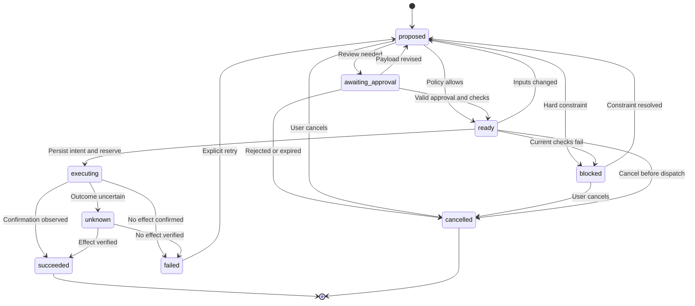

# Workflows and rules-based autonomy

_Design baseline · 2026-09-30 · Requirements R04, R09–R12, R14 · Decision ADR-04_

---

## 📋 Workflow stages

Monitoring and research retrieve observations, persist checkpoints, deduplicate, assess relevance, and enqueue preparation or notifications. Preparation generates materials and exact proposed actions. Execution is separate: it evaluates permissions, reserves limits, persists intent, dispatches a supported effect, and records observed confirmation. Models cannot directly enter the execution stage.

All externally visible LinkedIn operations, including accepting/declining a request, pass through the executor. Telegram notifications are user communication and use a separate notification queue; they are not employer-facing actions. User pause stops new research and outbound work; status, cancellation, reconciliation, and recovery controls remain available.

## 🔧 Policy and authorization

The application starts in `draft_only` mode. In `reviewed` mode each outbound action requires approval. In `rules_based` mode an action may proceed automatically when it satisfies the configured action-kind/channel permissions, target restrictions, eligibility rules, validated-input requirements, quotas, and capability release gate. The user selected `rules_based` as the target; the earlier modes are delivery and setup stages.

Daily application and communication caps begin at zero until the user sets them. Approval permits a specific otherwise reviewable action, but does not override pause, a zero/exhausted cap, unknown required facts, a challenge, an unresolved duplicate, or an unsupported capability. Telegram explains the block and exposes the relevant setting. Numerical quotas are operational limits, not a guarantee against platform restrictions.

`submit_application` uses the application cap; every other action kind uses the communication cap, including invitations and incoming-request decisions. Each dispatched logical effect reserves one slot. A confirmed no-effect failure releases its slot; a successful or unknown effect does not. Per-kind enablement remains separate from the shared numerical cap.

`ActionPolicy.evaluate()` returns:

| Decision | Conditions | Next behavior |
| --- | --- | --- |
| `allow` | All hard constraints pass; current rules authorize it or a valid approval exists | Reserve limits and move to `ready` |
| `require_approval` | Supported, complete action falls outside automatic selection rules or is in reviewed mode | Present exact action snapshot |
| `block` | Missing facts, target excluded, cap exhausted, unavailable capability, paused runtime, stale inputs, or unresolved effect | Record reasons; wait for a resolving change |

Actions include exact recipient/target, artifact hashes, answers/text, and the supporting profile/preferences revisions. Before dispatch, re-evaluate current policy, cap availability, source freshness, and action digest. Refresh target/form state during preparation; if questions, documents, recipient, or content change, create a new revision and invalidate approvals. A newly closed job blocks submission.

Approval expires after 24 hours by default and is consumed atomically when dispatch is committed. Silence never approves. Updating policy or profile forces re-evaluation; material changes require a new proposal. A match score alone never proves eligibility or grants permission.

## 📍 Action lifecycle

`unknown` is not a retryable error. It remains unresolved unless the connector verifies an outcome or the user records an explicit inspected-outcome attestation through the [Telegram resolution flow](telegram-interface.md). Keep those evidence types distinct. An expired approval enters `cancelled`; requesting another proposal is explicit. `failed` may return to `proposed` only after an explicit retry command and new policy evaluation. The baseline does not automatically retry writes.

Cancellation during `executing` cannot promise to undo a remote effect. Record a cancellation request, finish confirmation/reconciliation, and report the observed outcome. Withdrawing an application or deleting a sent message is outside the baseline action set.

## 🔗 Dispatch and recovery protocol

1. Prepare the supported form or message without clicking its final submit/send control. Persist the concrete revision and required facts.
2. Atomically verify readiness/revision, current authorization, logical-effect uniqueness, and available quota; reserve quota and create an attempt.
3. Persist `executing` and the dispatch marker immediately before the irreversible control. Consume approval, if used, in that transaction.
4. Dispatch once, then inspect channel-specific evidence. Store `succeeded`, `failed`, or `unknown` with sanitized reason and evidence.
5. Release a reservation only when no effect is confirmed; success counts against the applicable daily cap, and unknown outcomes retain their reservation.

On restart, attempts interrupted before a committed dispatch marker can return for preparation. Attempts with a marker or ambiguous timing become `unknown` and reconcile first. A process crash between committing the marker and clicking is deliberately conservative. Local persistence cannot make a remote website transaction atomic.

Daily quotas use the configured local date. An unresolved effect keeps its target blocked across day boundaries and is conservatively charged against current available capacity until resolved. Do not accumulate a backlog of stale writes to dispatch immediately after laptop resume.

## 🎯 Scheduling and failure isolation

Each periodic source has an independent `WorkItem` and checkpoint. Persist results before advancing cursors. Repeated reads are deduplicated; incomplete coverage does not close missing opportunities. On resume, coalesce overdue monitoring into one current run per workflow, then re-evaluate prepared outbound work rather than replay missed actions.

Capability failures stop only dependent work. An inbox challenge can leave company-board research operational. Telegram approval delivery failures leave actions pending; they do not enable fallback sending. Notifications may be retried with logical deduplication; a transport timeout can still cause a duplicate Telegram notification, which must not cause a duplicate action.

Acceptance: V09 tests policy and approvals; V11 tests restart at dispatch boundaries; V12 tests reconciliation and unknown outcomes; V13 tests recipient/follow-up rules; V14 tests schedule coalescing and pause. Shared fields and uniqueness rules live in [domain and data](domain-and-data.md).
